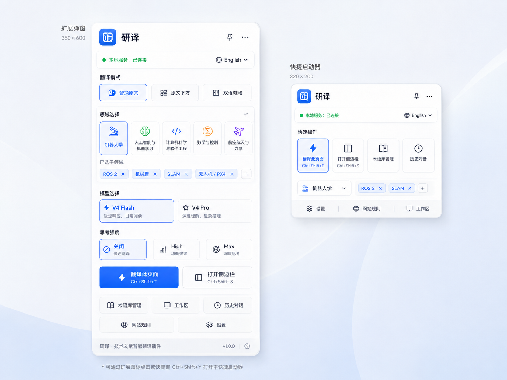
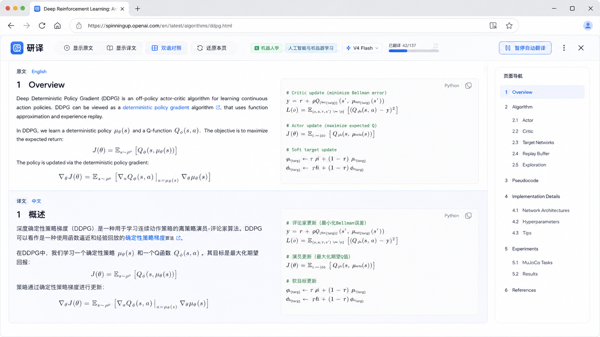
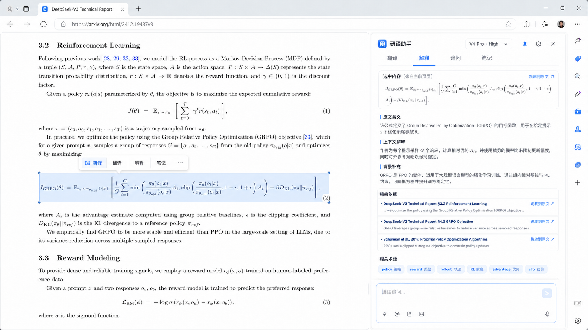
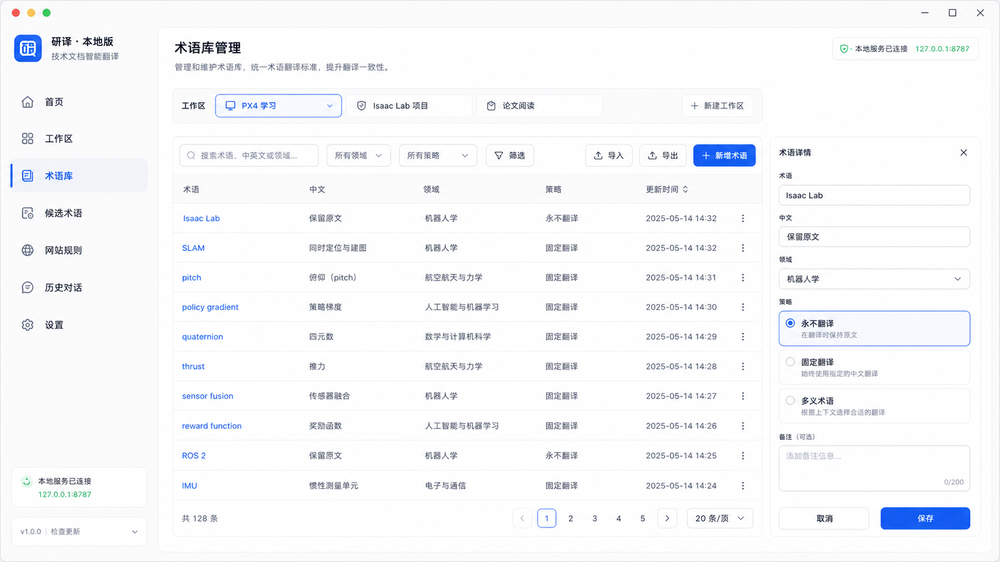
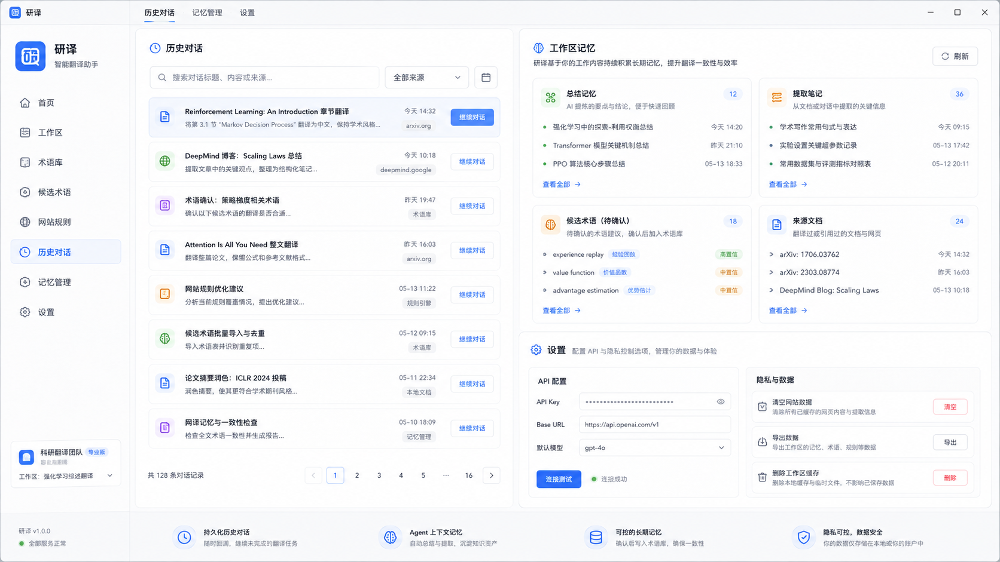
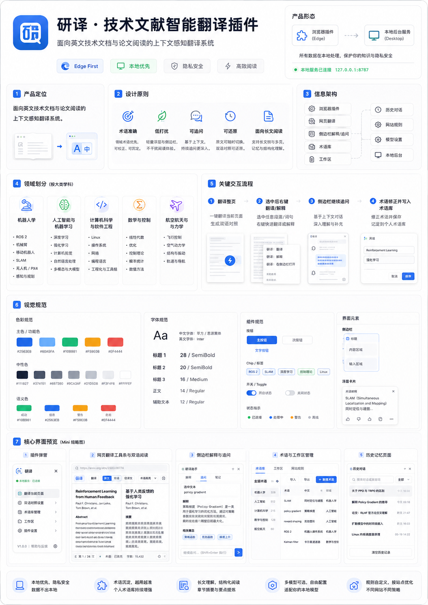

# 研译：界面与交互设计文档

> 文档版本：v1.0  
> 技术基线日期：2026-08-03  
> 首发平台：Microsoft Edge / Windows  
> 产品形态：浏览器扩展 + 本地后台管理端  
> 设计状态：可用于原型实现、组件拆分和设计验收

---

## 1. 文档目的

本文档定义“研译”浏览器翻译插件及其本地管理端的产品界面、信息架构、视觉规范、交互规则、状态表现和验收标准。

本文档回答以下问题：

1. 产品应当呈现哪些界面。
2. 每个界面承担什么任务。
3. 用户如何完成整页翻译、选中解释、继续追问、术语修正和历史恢复。
4. 领域分类、术语库、工作区和长期记忆如何展示。
5. 前端实现需要遵守哪些设计令牌、组件规范和可访问性要求。

设计图片是视觉方向参考；当图片中的细小文字、日期、模型名或布局与本文档冲突时，以本文档为准。

---

## 2. 产品定义

### 2.1 产品定位

“研译”是一套面向英文技术文档、论文和网页教程阅读的上下文感知翻译系统。它保留主流浏览器内置翻译的低操作成本，同时通过大模型、领域识别、术语保护、页面上下文和本地记忆解决以下问题：

- `Windows`、`Isaac Lab`、`ROS 2` 等专有名词被错误翻译或音译。
- `pitch`、`policy`、`plant` 等多义术语脱离专业语境。
- 公式、代码、命令、路径、引用编号和变量被破坏。
- 翻译结果不能解释，也不能针对当前段落继续追问。
- 用户修正无法沉淀为后续可复用的个人术语规则。
- 长文档翻译缺少工作区、历史、摘要和可控长期记忆。

### 2.2 首版目标

首版重点优化：

- 英文技术文档和论文 → 简体中文。
- Microsoft Edge。
- HTML 技术文档、GitHub 页面、arXiv HTML 页面和常见文档站点。
- 浏览器 PDF 中选中文字后的翻译、解释和追问；暂不改写 Edge 内置 PDF 阅读器的整页正文。
- DeepSeek API。
- 本地保存的术语、工作区、历史对话和记忆。

其他语言可以调用模型，但不承诺专业术语质量。

### 2.3 核心设计原则

1. **术语准确**：用户规则和领域术语优先于模型自由翻译。
2. **低打扰**：选中文字后默认不弹窗；用户通过右键、侧边栏或快捷键主动触发。
3. **页面可还原**：翻译不得成为不可逆的 DOM 改写。
4. **代码与公式安全**：默认保护所有代码、公式、变量、命令和路径。
5. **长文优先**：当前视口优先、块级渐进翻译、章节结构和阅读进度清晰。
6. **可追问**：解释和追问始终绑定原网页证据与当前上下文。
7. **记忆可控**：历史可以自动保存；永久术语和用户偏好必须经过用户确认。
8. **本地优先**：API 密钥、数据库和个人知识资产优先保存在用户设备。

---

## 3. 用户与核心场景

### 3.1 主要用户

首版主要用户是需要阅读英文技术资料的个人开发者、工科学生和研究人员。典型内容包括：

- GitHub README、Issue、Discussion 和源码文档。
- ROS 2、NVIDIA、PyTorch、PX4 等技术文档。
- arXiv HTML 论文。
- 算法教程、工程博客和 API 文档。

### 3.2 高频任务

| 任务             | 用户目标                       | 首选入口                |
| ---------------- | ------------------------------ | ----------------------- |
| 翻译当前网页     | 像浏览器内置翻译一样快速阅读   | 扩展弹窗主按钮          |
| 切换显示模式     | 原文、译文、双语之间切换       | 页面翻译工具条          |
| 精确翻译选中内容 | 获取当前术语或句子的学术中文   | 右键菜单 / 侧边栏       |
| 解释选中内容     | 理解公式、概念、段落或代码含义 | 右键“解释”              |
| 继续追问         | 基于当前网页上下文多轮对话     | Edge 侧边栏             |
| 修正术语         | 让后续翻译稳定采用指定译法     | 译文词语菜单 / 术语管理 |
| 恢复历史         | 继续之前的论文或教程阅读       | 历史对话 / 工作区       |
| 管理领域规则     | 为不同领域或网站调整翻译策略   | 本地管理端              |

---

## 4. 领域分类体系

### 4.1 分类原则

领域用于约束术语、提示词和上下文检索，不应按单个框架或软件划分。`ROS 2`、`PX4`、`Isaac Lab` 是子主题或技术标签，不是顶层学科。

系统采用：

- 一个主要领域。
- 最多两个辅助领域。
- 任意数量的技术标签。
- 自动识别后允许用户修改。
- 工作区可以设置默认领域和标签。

### 4.2 顶层领域

#### A. 机器人学与自主系统

子主题：

- ROS / ROS 2
- 机械臂、末端执行器、抓取与操作
- 移动机器人
- SLAM、定位与建图
- 路径规划、运动规划与导航
- 传感器融合
- 无人机、PX4 与自主飞行
- Isaac Sim / Isaac Lab、机器人仿真
- 多机器人系统
- 人机协作

#### B. 人工智能、机器学习与数据科学

子主题：

- 深度学习
- 强化学习
- 计算机视觉
- 自然语言处理
- 多模态与大模型
- 表示学习
- 概率机器学习
- 数据挖掘和数据工程
- 模型训练、评估与部署

#### C. 计算机科学与软件工程

子主题：

- 编程语言与编译器
- 数据结构与算法
- 操作系统与 Linux
- 网络与分布式系统
- 数据库
- 软件架构和工程化
- Web、桌面与移动开发
- 云计算、容器和 DevOps
- 信息安全
- API、SDK、工具链和构建系统

#### D. 数学、优化与控制

子主题：

- 线性代数
- 微积分与微分方程
- 概率统计
- 数值分析
- 凸优化与非线性优化
- 自动控制
- 最优控制
- 鲁棒控制与自适应控制
- 状态估计与滤波
- 系统辨识

#### E. 电子、通信与嵌入式系统

子主题：

- 电路与电子技术
- 数字逻辑
- 信号与系统
- 数字信号处理
- 通信原理
- 传感器与测量
- 微控制器、MCU 与嵌入式 Linux
- FPGA
- 实时系统
- 电机与驱动

#### F. 机械、航空航天与能源工程

子主题：

- 理论力学、材料力学与结构力学
- 机械设计与制造
- 振动与结构动力学
- 流体力学与空气动力学
- 飞行动力学与飞行控制
- 推进与动力系统
- 轨道、导航与制导
- 热力学与传热
- 能源系统

#### G. 物理、化学与材料科学

子主题：

- 经典物理与现代物理
- 光学、电磁学与量子技术
- 化学与化学工程
- 材料表征
- 金属、聚合物、陶瓷与复合材料
- 半导体与纳米材料

#### H. 生命科学、医学与生物工程

子主题：

- 生物学与生物信息学
- 医学影像
- 生物医学工程
- 神经科学
- 药物和临床研究

### 4.3 UI 表现

扩展弹窗只展示最近使用和自动识别出的 4–5 个大类，其他领域通过“更多领域”搜索选择。技术标签放在大类下方，以 Chip 显示，例如：

`机器人学与自主系统`  
`ROS 2` `机械臂` `SLAM` `无人机 / PX4`

不允许在同一层级同时出现“机器人学”和“ROS 2”。

---

## 5. 信息架构

### 5.1 浏览器扩展

- 扩展弹窗 / 快捷启动器
- 网页翻译工具条
- 右键菜单
- Edge 侧边栏
  - 翻译
  - 解释
  - 追问
  - 笔记
  - 当前上下文
  - 当前网页历史
- 页面内译文与术语交互
- 快捷键

### 5.2 本地管理端

- 首页
- 工作区
- 术语库
- 候选术语
- 网站规则
- 历史对话
- 记忆管理
- 模型与 API
- 隐私与数据
- 日志与诊断

### 5.3 数据关系

```text
工作区
├─ 默认领域与技术标签
├─ 网页和文档
├─ 会话
├─ 工作区术语
├─ 工作区笔记
├─ 摘要记忆
└─ 网站规则覆盖

用户全局
├─ API 配置
├─ 全局术语
├─ 永不翻译词
├─ 模型预设
├─ 通用偏好
└─ 数据与隐私设置
```

---

## 6. 导航模型

### 6.1 扩展弹窗

扩展图标点击后打开。弹窗是“快速启动器”，不是完整设置中心。

优先级顺序：

1. 服务状态与语言检测。
2. 翻译模式。
3. 领域与技术标签。
4. 模型预设。
5. “翻译此页面”主操作。
6. 打开侧边栏。
7. 术语、工作区、历史和设置入口。

### 6.2 侧边栏

侧边栏用于持续任务，不应复制扩展弹窗全部设置。顶部固定显示：

- 当前网页标题。
- 当前工作区。
- 模型预设。
- 当前上下文范围。

主体使用四个主标签：

- 翻译
- 解释
- 追问
- 笔记

### 6.3 本地管理端

固定左侧导航，宽度建议 220–240 px。页面内部使用面包屑或工作区切换，不使用多层折叠侧栏。

---

## 7. 页面详细设计

## 7.1 扩展弹窗

参考图：`design-assets/01_扩展弹窗与快捷启动器.png`



### 建议尺寸

- 默认宽度：380 px。
- 最大高度：640 px。
- 内容超出时仅中部滚动，标题和主操作保持可见。
- 紧凑启动器可使用 320 × 220 px，但首版不必单独实现两套界面。

### 模块

1. **标题栏**
   - Logo + “研译”。
   - 固定按钮。
   - 更多菜单。

2. **连接状态**
   - 已连接：绿色圆点 + “本地服务已连接”。
   - 连接中：蓝色加载状态。
   - 未连接：灰色或红色状态 + “启动本地服务”。

3. **语言检测**
   - 显示“English → 简体中文”。
   - 允许手动覆盖源语言。

4. **显示模式**
   - 替换原文。
   - 原文下方。
   - 双语对照。
   - 采用分段控制，不用单选下拉隐藏核心模式。

5. **领域**
   - 默认显示自动识别的主要领域。
   - 展开后显示大类网格和搜索框。
   - 技术标签在下方显示，支持删除和添加。

6. **模型预设**
   - 快速翻译。
   - 精确翻译。
   - 深度解释。
   - UI 可以显示模型名，但主要面向任务预设，避免普通用户理解 API 参数。

7. **主操作**
   - 唯一高强调按钮：“翻译此页面”。
   - 次操作：“打开侧边栏”。

8. **次级入口**
   - 术语库。
   - 工作区。
   - 历史对话。
   - 网站规则。
   - 设置。

### 状态

- 当前页已翻译：主按钮变为“更新翻译”或“继续翻译”。
- 翻译进行中：显示进度、暂停和取消。
- 当前页不可翻译：解释原因，不显示无效主按钮。
- PDF 页面：主按钮提示“选择文字后翻译或解释”。

---

## 7.2 网页翻译工具条

参考图：`design-assets/02_网页双语翻译界面.png`



### 目标

工具条用于在翻译过程中快速切换阅读状态，不承担复杂配置。

### 推荐结构

```text
研译 | 显示原文 | 显示译文 | 双语对照 | 还原本页
领域标签 | 模型预设 | 已翻译 42/137 | 暂停 | 更多 | 关闭
```

### 位置

默认使用页面顶部吸附条。为避免破坏网站布局：

- 使用 Shadow DOM 隔离样式。
- 固定定位，不插入网站原有导航流。
- 用户可以折叠为窄条。
- 网站全屏或演示模式下自动收起。

### 进度

- 进度使用“已完成块数 / 总块数”。
- 当前视口优先处理。
- 不以逐 Token 动画表现网页正文。
- 单个块完成并校验后一次性提交。

### 页面显示模式

#### 替换原文

- 原文本身保存在本地快照。
- 译文占据原节点位置。
- 悬停或快捷键可临时查看原句。

#### 原文下方

- 译文作为独立块插入原文之后。
- 使用浅色边界区分，不使用大面积背景色。
- 表格和列表保持原有层级。

#### 双语对照

- 对适合双栏的网站使用左右对照。
- 对窄页面或移动宽度自动降级为上下对照。
- 不强制改变代码块、公式和复杂表格的布局。

### 还原页面

“还原本页”必须：

- 停止新翻译任务。
- 移除插件插入的节点。
- 恢复原始文本快照。
- 恢复原属性和可见性。
- 不刷新网页。

---

## 7.3 页面选区与右键菜单

### 默认行为

鼠标选中文字后不自动弹出任何内容。

### 右键菜单

- 研译：翻译选中内容
- 研译：解释选中内容
- 研译：在侧边栏追问
- 研译：添加到术语库
- 研译：设为永不翻译

如果没有有效选区，隐藏选区相关菜单项。

### 可选浮动工具条

设置中允许用户开启。默认关闭。开启后仅在鼠标释放后出现，位置不能遮挡选区，按 `Esc` 关闭。

---

## 7.4 侧边栏解释与追问

参考图：`design-assets/03_侧边栏解释与追问.png`



### 布局

1. **顶部栏**
   - Logo 和“研译助手”。
   - 模型预设。
   - 固定、设置、关闭。

2. **标签栏**
   - 翻译。
   - 解释。
   - 追问。
   - 笔记。

3. **当前上下文卡片**
   - 当前选区。
   - 来源网页。
   - 当前章节。
   - “跳转到原文”。
   - “查看发送范围”。

4. **回答区**
   - 流式显示允许用于回答文本。
   - 每个回答可复制、保存笔记、反馈和引用。
   - 数学公式和代码使用专门渲染容器。

5. **输入区**
   - 支持多行。
   - `Enter` 发送，`Shift + Enter` 换行，允许用户在设置中反转。
   - 附件入口首版可隐藏，不提供无实现按钮。

### 解释结果结构

默认采用：

1. 原文含义。
2. 上下文解释。
3. 必要背景补充。
4. 相关依据。
5. 相关术语。

“原文内容”和“模型补充知识”必须通过标题或标签明确区分。

### 引用交互

每个引用包含：

- 来源标题。
- 原文短片段。
- 当前页面内的锚点。
- “跳转并高亮”。

模型不能生成无法定位到当前网页的虚假锚点。外部知识只作为“背景补充”，不伪装成当前网页引用。

### 上下文扩大

模型认为上下文不足时，侧边栏显示轻量状态：

`正在读取当前章节以补充上下文…`

不展示模型内部推理文本。用户可以展开“本次使用的上下文”查看实际发送片段。

---

## 7.5 术语交互

### 译文内术语

对于多义或需保留原文的术语，显示：

- `俯仰（pitch）`
- `策略（policy）`
- `Isaac Lab`

括号原文应由术语规则决定，不应对所有术语机械添加。

### 点击术语

出现受控菜单：

- 仅修改当前结果。
- 当前页面采用此译法。
- 保存到当前工作区。
- 保存到领域术语库。
- 设为永不翻译。
- 查看术语解释。

固定译法要求用户手动输入。模型可以建议，但不能未经确认写入正式术语库。

---

## 7.6 本地端：术语库与工作区

参考图：`design-assets/04_术语库与工作区管理.png`



### 页面结构

- 左侧全局导航。
- 顶部工作区切换器。
- 搜索、领域、策略和来源过滤。
- 术语表格。
- 右侧详情抽屉。

### 术语表格字段

- 原文术语。
- 中文译法。
- 顶层领域。
- 技术标签。
- 策略。
- 作用范围。
- 来源。
- 更新时间。

### 策略

- 永不翻译。
- 固定翻译。
- 多义术语。
- 首次出现附原文。
- 始终附原文。
- 当前页面临时规则。

### 多义术语编辑

一个词条可包含多条 Sense：

```text
pitch
├─ 飞行器姿态 → 俯仰（pitch）
├─ 螺旋桨几何 → 螺距（pitch）
└─ 声学 → 音高（pitch）
```

每条 Sense 包含：

- 条件描述。
- 领域。
- 技术标签。
- 推荐译法。
- 是否显示原文。
- 正例和反例。

### 工作区

工作区详情包含：

- 名称和描述。
- 默认领域。
- 默认模型预设。
- 网页与文档。
- 会话。
- 工作区术语。
- 摘要和笔记。
- 阅读进度。
- 导入、导出和归档。

---

## 7.7 候选术语

候选术语是模型自动提取但尚未被用户确认的内容。

每项显示：

- 原词。
- 建议译法。
- 出现次数。
- 来源页面。
- 推测领域。
- 置信度。
- 例句。

用户操作：

- 接受并编辑。
- 设为永不翻译。
- 合并到已有词条。
- 忽略。
- 批量处理。

置信度只能辅助排序，不能替代用户确认。

---

## 7.8 历史对话、记忆与设置

参考图：`design-assets/05_历史对话记忆与设置.png`



### 历史对话

列表项包含：

- 会话标题。
- 最近一条消息摘要。
- 来源网站或文档。
- 所属工作区。
- 更新时间。
- “继续对话”。

搜索支持标题、消息内容、来源域名和术语。

### 记忆管理

区分四类数据：

1. 自动摘要。
2. 用户保存的笔记。
3. 待确认候选术语。
4. 用户确认的长期记忆。

每条长期记忆必须显示：

- 内容。
- 来源。
- 写入时间。
- 适用工作区。
- 是否跨工作区。
- 编辑和删除。

### API 设置

- API Key。
- Base URL。
- 获取模型列表。
- 任务到模型的映射。
- 思考模式。
- 请求超时。
- 网络代理。
- 连接测试。

不得在 UI 中展示完整 API Key。

### 隐私与数据

- 清空当前网站数据。
- 清空翻译缓存。
- 导出工作区。
- 导出术语库。
- 删除工作区缓存。
- 删除完整工作区。
- 一键清空全部本地数据。

危险操作需要清晰说明影响范围和二次确认。

---

## 7.9 网站规则

网站规则页面支持：

- 域名匹配。
- URL 路径匹配。
- 默认翻译模式。
- 默认领域与技术标签。
- 忽略选择器。
- 强制翻译选择器。
- 动态页面策略。
- 是否自动翻译新增内容。
- 页面工具条位置。

示例：

```yaml
site: docs.ros.org
domain: 机器人学与自主系统
tags: [ROS 2]
default_mode: bilingual_below
ignore:
  - pre
  - code
  - .highlight
  - .version-switcher
```

首版界面提供可视化表单；高级用户可切换 JSON/YAML 预览，但不直接编辑内部数据库。

---

## 8. 视觉系统

参考总览：`design-assets/00_产品设计总览.png`



### 8.1 美学方向

关键词：

- 技术工具感。
- 克制、精确、可信。
- 明亮、低噪声。
- 高信息密度但不拥挤。
- 接近优秀开发者工具，而不是营销型 AI 产品。

避免：

- 大面积紫色渐变。
- 玻璃拟态滥用。
- 过度圆角和胶囊化。
- 没有层级的卡片堆叠。
- 每个区域都使用彩色图标。
- 无意义动画。
- 统一使用“AI 生成感”的默认布局。

### 8.2 色彩令牌

```css
:root {
  --color-bg: #f7f9fc;
  --color-surface: #ffffff;
  --color-surface-subtle: #f1f5f9;
  --color-border: #e2e8f0;
  --color-border-strong: #cbd5e1;

  --color-text: #0f172a;
  --color-text-secondary: #475569;
  --color-text-muted: #64748b;

  --color-primary: #2563eb;
  --color-primary-hover: #1d4ed8;
  --color-primary-soft: #eff6ff;

  --color-success: #16a34a;
  --color-warning: #d97706;
  --color-danger: #dc2626;
  --color-info: #0284c7;

  --focus-ring: 0 0 0 3px rgba(37, 99, 235, 0.25);
}
```

暗色模式不是首版阻塞项，但令牌必须支持后续扩展，禁止在组件中散落硬编码颜色。

### 8.3 字体

为降低体积和避免字体加载闪烁，首版使用系统字体：

```css
font-family: system-ui, 'Segoe UI', 'Microsoft YaHei UI', 'PingFang SC', sans-serif;
```

代码和术语原文：

```css
font-family: 'Cascadia Code', 'SFMono-Regular', Consolas, monospace;
```

### 8.4 字号

| 用途     | 字号 | 行高 | 字重 |
| -------- | ---: | ---: | ---: |
| 页面标题 |   24 |   32 |  650 |
| 区块标题 |   18 |   26 |  600 |
| 小标题   |   15 |   22 |  600 |
| 正文     |   14 |   22 |  400 |
| 辅助文字 |   12 |   18 |  400 |
| 微型状态 |   11 |   16 |  500 |

### 8.5 间距

使用 4 px 基础网格：`4, 8, 12, 16, 20, 24, 32, 40`。

- 卡片内边距：16 或 20 px。
- 表单行间距：16 px。
- 主区域间距：24 px。
- 弹窗紧凑布局可使用 12 px。

### 8.6 圆角和阴影

- 控件：8 px。
- 卡片：12 px。
- 弹窗和侧边栏内部卡片：10–12 px。
- 不使用 20 px 以上的大圆角作为默认。
- 阴影只用于浮层、弹窗和固定工具条；普通卡片以边框为主。

### 8.7 图标

推荐 Lucide 风格线性图标：

- 16 px：输入框、菜单。
- 18 px：按钮。
- 20 px：导航。
- 统一 1.75–2 px 描边。

不得混用多套风格差异明显的图标。

---

## 9. 组件规范

### 9.1 Button

- Primary：每个视图最多一个强主按钮。
- Secondary：边框按钮。
- Ghost：工具栏和表格操作。
- Danger：删除操作。
- 所有图标按钮必须提供 Tooltip 和 `aria-label`。

### 9.2 Chip

Chip 用于领域、技术标签、术语和状态。可删除 Chip 的关闭按钮至少 24 × 24 px 可点击区域。

### 9.3 Select / Combobox

领域和技术标签使用可搜索多选 Combobox。模型预设使用单选 Select。下拉层支持键盘导航。

### 9.4 Table

- 表头固定。
- 行高不低于 44 px。
- 支持列排序。
- 操作列使用菜单，不平铺过多按钮。
- 空状态提供下一步行动。

### 9.5 Drawer

术语详情优先使用右侧 Drawer，宽度 360–440 px。编辑未保存时关闭需要确认。

### 9.6 Toast

只用于短暂成功和非阻塞错误。关键失败必须在任务区域内提供可执行的错误状态。

### 9.7 Progress

整页翻译显示：

- 完成块数。
- 当前阶段。
- 暂停和取消。
- 对失败块提供重试入口。

---

## 10. 响应式与尺寸

### 10.1 Edge 扩展弹窗

- 360–420 px 宽。
- 不依赖浏览器页面宽度。
- 125% 和 150% Windows 缩放下不截断主操作。

### 10.2 侧边栏

- 最小宽度 320 px。
- 推荐宽度 420–480 px。
- 窄宽度时引用卡片使用纵向布局。
- 输入区始终保持可见。

### 10.3 本地管理端

- 最小窗口：1024 × 700。
- 推荐：1440 × 900。
- 1024 px 下右侧详情切换为覆盖式 Drawer。
- 低于 900 px 时允许左侧导航折叠。

---

## 11. 动效

- 页面内译文不做逐字动画。
- 侧边栏回答可以流式显示，但不得导致输入框跳动。
- 弹窗打开、Drawer 和菜单使用 120–180 ms 动画。
- 尊重 `prefers-reduced-motion`。
- 不使用持续呼吸、闪烁或循环背景动画。

---

## 12. 可访问性

最低目标：WCAG 2.1 AA 的核心要求。

必须实现：

- 全键盘操作。
- 清晰焦点环。
- 文字与背景对比度。
- 表单标签和错误关联。
- 状态不只通过颜色表达。
- 进度使用 `aria-live`，但避免高频播报。
- 流式回答完成后提供屏幕阅读器通知。
- 页面内插件 UI 使用 Shadow DOM 时仍保持可访问名称。
- 不劫持网站已有快捷键；冲突时允许用户修改。

---

## 13. 错误与空状态

### 13.1 本地服务未连接

显示：

- 原因。
- “启动本地服务”。
- “查看诊断”。
- 不清除已保存设置。

### 13.2 API 失败

显示：

- 哪个批次失败。
- 原页面未受损。
- 重试、跳过和取消。
- 不自动切换模型或降低质量。

### 13.3 公式或占位符校验失败

失败块保持原文，显示轻量标记；用户可单独重试。不得把未经校验的结果写回页面。

### 13.4 空历史

说明历史会在用户进行翻译、解释或追问后自动出现，并提供“打开示例文档”或“返回浏览器”的操作。

---

## 14. 前端实现约束

- 浏览器扩展：WXT + React + TypeScript + Manifest V3。
- 本地管理端：Tauri 2 + React + TypeScript + Rust。
- 组件：自有设计系统 + Radix primitives；避免直接堆叠未调整的默认 shadcn 样式。
- 样式：CSS Variables + Tailwind CSS 或等价原子化方案。
- 状态：Zustand。
- 异步数据：TanStack Query。
- 图标：Lucide。
- 页面注入 UI 使用 Shadow DOM。
- 所有 UI 文案集中管理，预留国际化结构。
- 设计令牌位于共享包，扩展和桌面端复用。

---

## 15. 前端设计 Skills 使用规范

建议将以下 Skills 固定到项目级目录，并锁定具体提交版本，避免每次构建从主分支动态拉取：

1. **Anthropic `frontend-design`**：用于新界面实现和视觉精修。
2. **Microsoft `frontend-design-review`**：用于设计系统、一致性、可访问性和可信体验审查。
3. **Vercel `web-design-guidelines`**：用于 UI 代码审查；其规则文件必须固定到项目内的已审核版本。

使用顺序：

```text
读取本文档与设计图
→ frontend-design 实现
→ Playwright 生成截图
→ frontend-design-review 审查
→ web-design-guidelines 审查
→ 修复并重新截图
```

不得让 Skill 的通用美学偏好覆盖本文档的产品约束。本文档和设计令牌优先级更高。

---

## 16. 设计验收清单

### 扩展弹窗

- 主操作在 3 秒内可识别。
- 不出现超过一个高强调按钮。
- 领域使用大类 + 子标签结构。
- 本地服务状态明确。
- Windows 150% 缩放下无裁切。

### 网页翻译

- 公式、代码、链接和引用不被破坏。
- 工具条不改变网站原布局。
- 可以完整还原页面。
- 翻译正文不逐 Token 抖动。
- 动态页面不重复翻译插件自己的节点。

### 侧边栏

- 选区、来源和上下文范围清晰。
- 回答可继续追问。
- 引用可跳转并高亮原文。
- 原文内容和背景补充明确区分。
- 历史关闭浏览器后仍可恢复。

### 本地管理端

- 术语可搜索、筛选和批量处理。
- 多义术语可编辑多个 Sense。
- 工作区记忆隔离。
- 所有长期记忆可查看来源、编辑和删除。
- API Key 不明文显示。

---

## 17. 设计资产

| 文件                                 | 用途                                   |
| ------------------------------------ | -------------------------------------- |
| `assets/00_产品设计总览.png`         | 产品定位、信息架构、领域和视觉系统总览 |
| `assets/01_扩展弹窗与快捷启动器.png` | 扩展弹窗视觉基准                       |
| `assets/02_网页双语翻译界面.png`     | 页面工具条与双语阅读基准               |
| `assets/03_侧边栏解释与追问.png`     | 选区解释、引用和追问基准               |
| `assets/04_术语库与工作区管理.png`   | 本地端术语管理基准                     |
| `assets/05_历史对话记忆与设置.png`   | 历史、记忆、API 和隐私页面基准         |

---

## 18. 官方技术依据

- Microsoft Edge Sidebar：<https://learn.microsoft.com/en-us/microsoft-edge/extensions/developer-guide/sidebar>
- Microsoft Edge Native Messaging：<https://learn.microsoft.com/en-us/microsoft-edge/extensions-chromium/developer-guide/native-messaging>
- WXT Manifest：<https://wxt.dev/guide/essentials/config/manifest.html>
- Tauri 2 SQL Plugin：<https://v2.tauri.app/reference/javascript/sql/>
- DeepSeek 模型列表：<https://api-docs.deepseek.com/zh-cn/api/list-models/>
- DeepSeek 模型与价格：<https://api-docs.deepseek.com/zh-cn/quick_start/pricing>
- Anthropic Frontend Design Skill：<https://github.com/anthropics/skills/tree/main/skills/frontend-design>
- Microsoft Frontend Design Review Skill：<https://github.com/microsoft/skills/tree/main/.github/skills/frontend-design-review>
- Vercel Web Design Guidelines Skill：<https://github.com/vercel-labs/agent-skills/tree/main/skills/web-design-guidelines>
